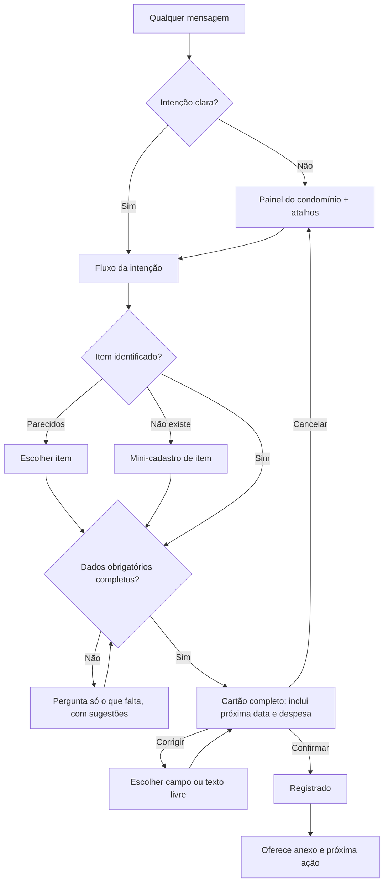

# Registro de problemas de usabilidade · Easy Maintenance (produção)

Registro contínuo dos testes do Tiago no backoffice e no copiloto Samu (WhatsApp), usando o Condomínio Edifício Veneza como base de teste. Para relatar ao time em bloco.

Severidade: **Crítica** (grava dado errado ou bloqueia) · **Alta** (impede tarefa comum ou induz a erro) · **Média** (atrito ou confusão) · **Baixa** (acabamento).

Última atualização: 08/11/2026, 10h30

**Conteúdo:** Parte A, registro de problemas (seções 1 a 4) · Parte B, proposta de reestruturação do fluxo conversacional do Samu (seção 5).

# Parte A · Registro de problemas

---

## 1. Copiloto Samu (WhatsApp)

### Teste 1 · 08/11/2026 (registro de caixa de gordura, poda, consultas)

| ID | Sev. | Problema | Evidência |
| --- | --- | --- | --- |
| WA-01 | Crítica | "Corrigir" não funcionou ao trocar o **item**: o bot repetiu "Antes, confirme (ou corrija/cancele)" e a única saída foi confirmar o registro errado. No teste 2, a correção de **data e custo** funcionou, então a falha parece específica da troca de item (ou do texto livre "o item é X"). | "o item é caixa de gordura, não é gerador" ignorado duas vezes; registro gravado como Gerador. |
| WA-02 | Crítica | Item identificado errado e duplicado: "caixa de gorduro" virou item novo **Gerador** (Regulatório, periodicidade pela norma), embora já existisse "Limpeza caixa de gordura · Garragem subsolo". Não há busca aproximada nos itens do condomínio. | maintenanceId=19 gravado no item errado. |
| WA-03 | Alta | Campos mal preenchidos: responsável = "emergencial"; horário 09:00 ignorado; descrição é o texto cru e cortado. | Cartão de confirmação do registro 19. |
| WA-04 | Alta | Perguntas dentro do escopo caem na resposta genérica ("Por aqui eu te ajudo só com..."): alterar vencimento, anexar imagem, "e para caixa de godura?". Sem compreensão fora dos botões e sem contexto da pergunta anterior; usuário digitou "menu" 4 vezes. | Transcrição do teste 1. |
| WA-05 | Alta | Sem caminho para anexar evidência: a instrução diz "pode mandar foto junto", mas a pergunta foi recusada e o bot não oferece anexar depois do registro. | "posso anexar uma imagem?" → resposta genérica. |
| WA-06 | Média | Cartão de confirmação não mostra o próximo vencimento nem a regra usada; usuário confirma às cegas (poda: próximo em 21 dias sem aviso). Repetido no teste 2. | Registros 19, 20 e alarme de incêndio. |
| WA-07 | Média | Data marcada como "não informada — usei hoje" quando foi informada ("feita hj às 08:00"). | Registro 20. |
| WA-08 | Média | Mensagem enviada logo após tocar em "Registrar manutenção" é descartada (corrida de estado). | "poda de jardim" → resposta genérica. |
| WA-09 | Média | Histórico responde "Ainda não há manutenções registradas para Extintor" embora o item esteja em dia no painel (data só no item, sem registro em maintenances). | Consulta "última manutenção dos extintores". |
| WA-10 | Baixa (produto) | Não é possível alterar o próximo vencimento pelo bot. | Primeira pergunta do teste 1. |
| WA-11 | Média | Menu principal sem consultar histórico, anexar evidência nem lançar receita/despesa (prometido no documento aos sócios: "lançar receitas e despesas pelo WhatsApp"); "Nova empresa" aparece no menu do dia a dia do síndico. | Menu "Escolher": Vencimentos da semana, Itens vencidos, Registrar manutenção, Nova empresa. |
| WA-12 | Baixa | Negrito quebrado no nome do condomínio: "*Condomínio Edifício Veneza *" (espaço antes do asterisco) aparece com os asteriscos. | Saudação e "Itens vencidos". |

### Teste 2 · 08/11/2026 (itens vencidos e atualização do alarme de incêndio)

| ID | Sev. | Problema | Evidência |
| --- | --- | --- | --- |
| WA-13 | Alta | "Quero atualizar a manutenção do alarme de incêndio" vira direto um cartão de registro com **data de hoje assumida** e tipo preventiva, sem perguntar o que foi feito nem quando. "Atualizar" pode significar registrar algo já feito ou remarcar; um toque em Confirmar gravaria uma manutenção que não aconteceu. Data é obrigatória e não deve ser presumida. | Cartão das 10:21: "08/11/2026 (não informada — usei hoje)". |
| WA-14 | Média | A descrição recebe a frase de intenção ("quer atualizar a manutenção do alarme de incendio") em vez de uma descrição do serviço, e continua assim depois da correção. | Cartões das 10:21 e 10:22. |
| WA-15 | Média | Lista de vencidos mostra datas sem ano: "venceu em 08/11 (há 730 dias)" parece hoje. Mostrar o ano quando não for o atual. Itens vencidos há 1–2 anos indicam cadastro inicial sem última manutenção; o bot poderia perguntar a data real. | Equipotencialização (730 dias), Simulado abandono (452), Caixa d'água (250). |
| WA-16 | Média | A lista de vencidos não oferece ação por item (registrar manutenção, pedir orçamento, ver fornecedor); o usuário precisa digitar o pedido. | Mensagem "Itens vencidos" termina só com o link. |
| WA-17 | Verificar | No teste 1 o bot respondeu "Nenhum item vencido" e no teste 2 lista 8. Confirmar se a diferença vem dos cadastros feitos entre os testes (provável) ou de inconsistência no cálculo. | Respostas de "Itens vencidos" nos dois testes. |
| WA-18 | Verificar | "Gerador" aparece entre os vencidos (venceu 08/10). Confirmar se é o item criado por engano no WA-02 ou outro, e limpar. | Lista do teste 2. |

### Teste 3 · 08/11/2026 (navegação e menu)

| ID | Sev. | Problema | Evidência |
| --- | --- | --- | --- |
| WA-19 | Alta | "Vencimentos da semana" responde "✅ Nada vence nos próximos 7 dias" enquanto há 8 itens vencidos. O check verde passa a ideia de que está tudo em dia. Atrasados precisam aparecer junto (ou ao menos um aviso "mas há 8 vencidos"). | Resposta das 10:27 vs. lista de vencidos das 10:19. |
| WA-20 | Alta | É preciso digitar "menu" para começar ou retomar; mensagens livres caem na resposta genérica. A conversa deveria começar com qualquer mensagem. | Testes 1, 2 e 3. |
| WA-21 | Alta | O menu não cobre cenários centrais: abrir chamado, consultar chamados abertos por SLA, histórico de item, alterar vencimento, cadastrar fornecedor, lançar despesa, anexar evidência (amplia o WA-11). | Menu "Escolher" com 4 opções. |
| WA-22 | Alta | Cadastro de item novo pelo chat é frágil: cria item sem confirmar tipo, local, categoria e periodicidade, e não oferece itens parecidos já cadastrados (ver WA-01, WA-02). | Item "Gerador" criado no teste 1. |
| WA-23 | Média | A data da próxima manutenção é pedida ou aparece como exemplo de correção ("a cada 6 meses") mesmo quando já está definida pelo item ou pela norma. O padrão deveria ser calcular e mostrar; o usuário só altera por exceção. | Instrução de correção; cartões sem a próxima data. |

**O que funcionou no teste 2:** o bot achou o item certo pelo nome ("alarme de incêndio"), e a correção de data e custo em texto livre ("feita no dia 17/10/2026 e custou 80,00") foi aplicada corretamente.

**Decisões de produto pendentes:**
- Manutenção emergencial/corretiva reinicia o ciclo preventivo? Proposta: por padrão não; perguntar quando o tipo for corretiva/emergencial.
- "Atualizar manutenção" deve abrir uma pergunta de desambiguação: "Foi feita uma manutenção (quando?) ou quer mudar a data do próximo vencimento?".

## 2. Itens e locais (backoffice)

| ID | Sev. | Problema | Evidência |
| --- | --- | --- | --- |
| IT-01 | Alta | Áreas comuns não existem como cadastro; o local do item é texto livre (`location_label`, 80 caracteres), gerando grafias diferentes e sem visão por local. Chamado de morador sem local nem item. | "Garragem subsolo", "portaria e garagens"; item de backlog "Cadastro de Locais" já redigido em 04/11. |
| IT-02 | Média | Novo Item pede o tipo antes do local, ao contrário de como o síndico levanta o prédio. | Tela Novo Item. |
| IT-03 | Média | Unidades listadas soltas (Pessoas e Papéis › Unidades), fora de uma estrutura torre/andar. | Tela Unidades. |

## 3. Financeiro (backoffice) · 08/11/2026

| ID | Sev. | Problema | Evidência |
| --- | --- | --- | --- |
| FI-01 | Alta | Lançamento só pode ser cancelado: falta **editar** e **clonar** (despesas recorrentes como administradora, elevador e limpeza são redigitadas todo mês). | Lista de despesas: só botão "Cancelar". |
| FI-02 | Alta | Visão não é agrupada por mês nem mostra acumulado; sem totais de receitas, despesas e saldo por mês e no período. | Lista plana de jan a nov/2026. |
| FI-03 | Média | Categorias inconsistentes para o mesmo lançamento: a administradora (R$ 1.287,85) aparece ora como "Serviço de terceiro", ora como "Folha de pagamento". Faltam categorias específicas (administradora, manutenção, concessionárias, seguro, fundo de reserva, fundo de obras). | Linhas de 10/08 e 06/02 vs. demais. |
| FI-04 | Média | Formulário "Nova receita" usa ícone de alerta vermelho (triângulo) e botão "Lançar" vermelho, semântica de erro numa ação normal; o botão "Nova receita" é verde, o modal é vermelho. | Modal Nova receita. |
| FI-05 | Média | Formulário sem campos essenciais à prestação de contas: competência, conta/fundo (ordinária, reserva, obras), unidade, fornecedor, nº do documento, anexo, recorrência/parcelas. | Modal Nova receita: só categoria, valor, data, descrição. |
| FI-06 | Baixa | Sem "lançar e continuar" para lançamentos em sequência (ex.: 3 receitas do mês). | Modal fecha a cada lançamento. |
| FI-07 | Baixa | Filtro só por período e tipo; sem filtro por categoria nem busca por descrição. | Barra de filtros. |

## 4. Integração manutenção ↔ financeiro · 08/11/2026

| ID | Sev. | Problema | Evidência |
| --- | --- | --- | --- |
| IN-01 | Alta | O custo informado no registro de manutenção (backoffice ou WhatsApp) não gera lançamento no financeiro. O síndico precisa lançar a mesma despesa de novo, a prestação de contas fica incompleta e não é possível responder "quanto gastei com o elevador?" cruzando os dois módulos. | Manutenções com custo (caixa de gordura R$ 300, poda R$ 180, alarme de incêndio R$ 80) não aparecem em Financeiro › Despesas. |

**Proposta de comportamento:**
- Ao salvar uma manutenção com custo, oferecer **"Lançar como despesa"** (marcado por padrão), com data de pagamento (padrão = data do serviço), categoria sugerida pelo tipo (preventiva → manutenção preventiva; corretiva/emergencial → manutenção corretiva) e fornecedor herdado.
- Guardar o vínculo nos dois sentidos (`maintenance_id` no lançamento; link "Ver despesa" na manutenção). Editar ou cancelar um lado avisa sobre o outro.
- **Evitar duplicidade:** se o item tem contrato recorrente já lançado (ex.: elevador R$ 304,45/mês), sugerir **vincular** ao lançamento existente do mês em vez de criar outro. Também sugerir vínculo quando já houver despesa de mesmo valor e fornecedor em ±7 dias.
- **Parcelamento:** permitir informar parcelas (ex.: reparo do elevador em 8x), gerando os lançamentos futuros.
- No WhatsApp, o cartão de confirmação mostra "💰 R$ 80,00 · será lançado como despesa em 17/10" e permite desmarcar.

**Decisão de produto pendente:** o custo da manutenção é o valor **pago** (gera despesa) ou só **referência** (ex.: valor coberto por contrato ou garantia, sem pagamento)? Proposta: perguntar quando houver contrato ou garantia vigente para o item.


---

# Parte B · Proposta de reestruturação do fluxo conversacional do Samu

## 5.1 Diagnóstico em uma frase

Hoje o Samu é um **menu com portão**: só funciona depois de "menu", cobre 4 cenários, adivinha o que falta (data de hoje, item novo) em vez de perguntar, e pede o que o sistema já sabe (próxima data). A proposta inverte isso: **qualquer mensagem abre a conversa, o bot mostra o que precisa antes de pedir, calcula o que já sabe e só pergunta o que falta.**

## 5.2 Princípios

1. **Sem portão.** Qualquer mensagem (oi, uma foto, "o portão quebrou", um áudio) inicia ou retoma a conversa. "menu" continua funcionando, mas não é obrigatório.
2. **Texto livre primeiro, botões como atalho.** O bot classifica a intenção da mensagem; os botões aceleram, não são o único caminho.
3. **Mostrar o formato antes de pedir.** Cada entrada exibe um modelo com os dados necessários e um exemplo preenchido. O usuário responde tudo numa mensagem ou aos poucos.
4. **Calcular o que o sistema já sabe.** Próxima data, categoria, norma, fornecedor habitual e local vêm do cadastro; aparecem no cartão para conferência, nunca como pergunta.
5. **Nunca presumir dado obrigatório.** Item e data da manutenção são obrigatórios: se faltarem, o bot pergunta (com sugestões), não preenche "hoje".
6. **Anexo a qualquer momento.** Foto ou PDF é aceito em qualquer etapa e sempre oferecido depois de um registro.
7. **Contexto curto.** O bot lembra o último item, condomínio e fluxo por 30 minutos ("e para a caixa de gordura?").
8. **Confirmar com tudo à vista.** O cartão final mostra todos os campos, inclusive próxima data, regra usada e lançamento financeiro, com "Corrigir" campo a campo.

**Limites do WhatsApp considerados:** até 3 botões de resposta por mensagem (título até 20 caracteres) e listas com até 10 linhas no total (título até 24 caracteres). A navegação abaixo cabe nesses limites.

## 5.3 Entrada: painel em vez de "menu"

Qualquer primeira mensagem do dia (ou depois de 30 minutos parado) recebe um **resumo do condomínio** com atalhos para o que é urgente:

```
Olá, Tiago! 👋 Condomínio Edifício Veneza
⚠️ 8 itens vencidos · 📅 0 vencem esta semana
🛎️ 2 chamados abertos · 1 fora do SLA

Me diga o que precisa ou escolha abaixo.
[ Ver vencidos ]  [ Chamados ]  [ Mais opções ]
```

Se a primeira mensagem já tem uma intenção clara ("troquei a lâmpada da garagem hoje"), o bot pula o painel e vai direto ao fluxo.

**"Mais opções" (lista com seções, 10 linhas):**

| Seção | Opção | Descrição curta na lista |
| --- | --- | --- |
| Manutenção | Registrar manutenção | Algo que já foi feito |
| Manutenção | Vencidos e próximos | Atrasados, 7 e 30 dias |
| Manutenção | Histórico de um item | Última vez, quem fez, quanto |
| Manutenção | Alterar vencimento | Remarcar a próxima data |
| Chamados | Abrir chamado | Problema em área comum |
| Chamados | Chamados por SLA | Fora do prazo primeiro |
| Fornecedores | Fornecedor | Cadastrar ou vincular a item |
| Financeiro | Lançar despesa/receita | Com foto do comprovante |
| Conta | Trocar condomínio | Veneza, outros |
| Conta | Itens e locais | Cadastrar item novo |

"Nova empresa" sai do menu do dia a dia e fica em "Trocar condomínio".

## 5.4 Fluxos

### A. Registrar manutenção

**1. Pedido com modelo.** Ao escolher a opção (ou quando a intenção é detectada sem dados suficientes):

```
Me conte numa mensagem 👇 (pode ser áudio ou foto do recibo)
• Item: qual equipamento ou serviço
• Quando: hoje, ontem, 17/10
• O que foi feito
• Tipo: preventiva, corretiva ou emergencial
• Valor e quem fez (opcional)

Ex.: "Limpeza da caixa de gordura ontem, emergencial, R$ 300, Desentupidora Rápida"
📎 Pode mandar foto ou laudo junto.
```

Junto, uma lista curta de **itens sugeridos** (vencidos e mais usados) para quem prefere tocar.

**2. Identificação do item (obrigatória, com busca aproximada).**
- Encontrou um item com segurança: segue.
- Encontrou parecidos: `Achei estes. É algum deles?  [Limpeza caixa de gordura · Garagem]  [Outro item]  [Criar item novo]`.
- Não encontrou: abre o mini-cadastro de item (fluxo E), sem sair da conversa.

**3. Dados faltantes, um por vez, com sugestão.** Data ausente: `Quando foi feita?  [Hoje]  [Ontem]  [Outra data]`. Tipo ausente com sinais de conserto ("quebrou", "trocou"): sugere corretiva.

**4. Cartão de confirmação completo.**

```
Confere? 📝
🔧 Limpeza caixa de gordura · Garagem subsolo
📅 07/11/2026 às 09:00 · 🛠 Emergencial
👷 Desentupidora Rápida · 💰 R$ 300,00
📝 Limpeza emergencial por entupimento
⏭️ Próxima: 07/05/2027 (a cada 6 meses, do item)
💸 Lançar despesa de R$ 300,00 em 07/11 ✔️

[ Confirmar ]  [ Corrigir ]  [ Cancelar ]
```

- **Corrigir** abre a lista de campos (Item, Data, Tipo, Valor, Quem fez, Próxima data, Despesa); escolher o campo pergunta só aquele valor. Texto livre ("custou 200", "o item é caixa de gordura") também funciona, inclusive para trocar o item.
- Depois de corrigir, o cartão é reapresentado. Nunca há um estado em que a única saída seja confirmar.

**5. Pós-registro com evidência.**

```
✅ Registrado! Próxima limpeza em 07/05/2027.
📎 Quer anexar foto ou nota? É só mandar agora.
[ Anexar depois ]  [ Registrar outra ]
```

Fotos que chegarem nos 10 minutos seguintes vão para esse registro, com confirmação: `Anexei ao registro de 07/11 ✅`.

### B. Próxima data da manutenção (regra)

| Situação | Comportamento |
| --- | --- |
| Item com norma | Calcula pela norma e mostra: "Próxima: 10/10/2027 (anual, ABNT NBR 12962)". Não pergunta. |
| Item operacional com periodicidade | Calcula pela periodicidade do item e mostra. Não pergunta. |
| Item sem periodicidade | Pergunta uma vez com sugestões do catálogo: `A cada quanto tempo?  [3 meses]  [6 meses]  [1 ano]` e grava no item. |
| Documento com validade (laudo, AVCB, certificado) | Usa a validade lida do documento e mostra a origem: "válido até 20/08/2027 (laudo)". |
| Corretiva ou emergencial | Pergunta: `Isso reinicia o ciclo preventivo?  [Sim]  [Não, manter 10/12]`. Padrão: não. |
| Usuário quer outra data | Pelo campo "Próxima data" do Corrigir ou pelo fluxo "Alterar vencimento", com motivo registrado. |

### C. Vencidos e próximos

Uma só resposta com três blocos, sempre com o ano quando diferente do atual:

```
⚠️ Vencidos (8)
1. Equipotencialização · venceu 08/11/2024
2. Simulado de abandono · venceu 13/08/2025
...
📅 Próximos 7 dias (0) · 🗓️ Próximos 30 dias (2)

Escolha um item para agir 👇   [ Ver lista ]
```

A lista leva a ações por item: `[ Já foi feito ]  [ Pedir orçamento ]  [ Remarcar ]`. "Já foi feito" abre o fluxo A com o item preenchido; itens vencidos há mais de 1 ano disparam a pergunta "Você sabe quando foi feito pela última vez?".

### D. Alterar vencimento

Item (com sugestões) → nova data (`[+7 dias]  [+30 dias]  [Outra data]`) → motivo (`[Fornecedor remarcou]  [Validade do laudo]  [Erro no cadastro]`) → confirmação mostrando a data antiga e a nova. Fica registrado no histórico do item.

### E. Cadastrar item novo (dentro de outro fluxo ou pelo menu)

```
Vamos cadastrar "caixa de gordura" 👇
• Tipo: escolha ou confirme (busco no catálogo)
• Local: onde fica (garagem, cobertura, casa de bombas...)
• Última manutenção: data, se souber
• Fornecedor habitual (opcional)
📎 Foto da etiqueta ou placa ajuda: eu leio os dados.
```

- O tipo vem do catálogo: se tem norma, o bot informa "Regulatório, anual pela NBR X" e não pergunta periodicidade; se não tem, pergunta com sugestões.
- O local vem da lista de locais do condomínio (depende do item de backlog **Cadastro de Locais**); enquanto não existir, sugerir os locais já usados para evitar grafias diferentes.
- Cartão de confirmação do item antes de criar. Item novo nunca é criado em silêncio.

### F. Chamados

**Abrir chamado (síndico ou zelador pelo WhatsApp):**

```
O que aconteceu e onde? 📎 Mande foto se puder.
Ex.: "Lâmpada queimada no hall do 3º andar"
```

O bot sugere local e item relacionados, pergunta a urgência (`[Urgente]  [Normal]  [Baixa]`), mostra o SLA resultante ("resolver até 10/11, 18h") e confirma.

**Chamados por SLA:**

```
🛎️ Chamados abertos (5)
🔴 Fora do SLA (1): Portão não fecha · aberto há 3 dias
🟠 Vence hoje (1): Vazamento garagem
🟢 No prazo (3)
[ Ver fora do SLA ]  [ Ver todos ]
```

Cada chamado leva a: `[ Atualizar status ]  [ Acionar fornecedor ]  [ Responder morador ]`. Ao concluir, oferece registrar a manutenção correspondente (fluxo A) com item e foto já preenchidos.

### G. Fornecedor: cadastro e vínculo a itens

**Cadastro**, por três caminhos à escolha:
- **Compartilhar contato** do WhatsApp (o bot lê nome e telefone do cartão de contato).
- **Foto** do cartão, da nota fiscal ou do contrato (o bot lê nome, CNPJ, telefone e, no contrato, vigência e valor).
- **Digitar**, com modelo:

```
Me mande os dados do fornecedor 👇
• Nome
• Telefone (WhatsApp)
• CNPJ (opcional)
• O que ele faz: elevador, extintores, limpeza...
Ex.: "Elevar Elevadores, 31 99999-0000, manutenção de elevador"
```

**Sequência:**
1. Busca na base pelo CNPJ ou nome para não duplicar: `Já existe "Elevar Elevadores BH". É ele?  [Sim]  [Não, é outro]`.
2. Categorias sugeridas pelo que ele faz.
3. `Tem contrato com o condomínio?  [Sim]  [Não, é avulso]`. Se sim: início, fim, valor e periodicidade, ou foto do contrato para leitura.
4. **Vínculo a itens:** lista dos itens da categoria do fornecedor, marcados por padrão os que não têm fornecedor habitual: `Ele atende quais itens? 1. Elevador (sem fornecedor) 2. ...  [ Todos ]  [ Escolher ]`.
5. Confirmação com o resumo: fornecedor, categorias, contrato (com alerta se vencido ou vencendo em 60 dias) e itens vinculados.
6. Opcional: `Quer que eu envie um convite para ele confirmar visitas pelo WhatsApp?`.

**Uso no dia a dia:** em "Vencidos" e "Chamados", o botão "Acionar fornecedor" usa o fornecedor habitual do item e mostra se ele tem contrato vigente.

### H. Lançar despesa ou receita

Modelo com valor, data, categoria e descrição, e **foto do comprovante** (o bot lê valor, data e fornecedor). Quando a despesa é de manutenção, oferece vincular ao registro do item (ver IN-01).

### I. Anexo sem contexto

Se chega uma foto ou PDF fora de um fluxo:

```
Recebi o arquivo 📎 O que é?
[ Evidência do último registro ]  [ Documento para ler ]  [ Outro ]
```

"Documento para ler" identifica o tipo (laudo, nota, contrato, etiqueta) e propõe a ação: registrar manutenção, atualizar validade, cadastrar fornecedor ou lançar despesa.

### J. Comandos que funcionam em qualquer ponto

`voltar` (etapa anterior) · `cancelar` (descarta o fluxo) · `menu` (painel) · `trocar condomínio`.

## 5.5 Mapa de estados (resumo)



## 5.6 Critérios de aceite (casos dos testes de 08/11)

| Entrada | Esperado |
| --- | --- |
| "oi" ou qualquer texto sem fluxo ativo | Painel do condomínio, sem pedir "menu". |
| "manutenção da caixa de gorduro ontem, R$ 300" | Sugere "Limpeza caixa de gordura · Garagem subsolo"; não cria item novo. |
| Corrigir → "o item é caixa de gordura" | Troca o item e reapresenta o cartão. |
| "quero atualizar a manutenção do alarme" | Pergunta: "Foi feita uma manutenção ou quer remarcar?"; não presume a data. |
| "feita hj às 08:00" | Data de hoje, 08:00, sem a marca "não informada". |
| Item com norma ou periodicidade | Cartão mostra a próxima data e a regra; não pergunta. |
| "Vencimentos da semana" com itens atrasados | Mostra os atrasados junto; nunca "✅ nada vence" se houver vencidos. |
| "posso anexar uma imagem?" | "Pode! Mande agora" e vincula ao último registro. |
| "e para caixa de gordura?" depois de consultar histórico | Responde o histórico da caixa de gordura. |
| Compartilhar contato de um fornecedor | Inicia o cadastro de fornecedor com nome e telefone preenchidos. |
| Manutenção com custo | Cartão mostra o lançamento da despesa; confirmado, aparece no financeiro. |

## 5.7 Métricas para acompanhar a mudança

- **Taxa de resposta genérica** ("Por aqui eu te ajudo só com..."): meta abaixo de 5% das mensagens.
- **Registros concluídos ÷ registros iniciados** e **mensagens por registro concluído**.
- **Taxa de correção** por registro e campo mais corrigido.
- **Registros com evidência anexada.**
- **Itens novos criados pelo chat que depois foram excluídos ou mesclados** (proxy de erro de identificação).

## 5.8 Ordem sugerida de entrega

1. **Correções de dado** (evitam registro errado): Corrigir funcional para todos os campos, item obrigatório com busca aproximada, data nunca presumida, cartão completo com próxima data.
2. **Entrada sem portão:** qualquer mensagem abre o painel; intenções em texto livre; contexto curto.
3. **Novos fluxos de alto uso:** vencidos com ações por item, chamados (abrir e por SLA), anexo a qualquer momento.
4. **Cadastros pelo chat:** fornecedor com vínculo a itens, item novo completo, alterar vencimento.
5. **Financeiro pelo chat** e integração com manutenção (IN-01).
